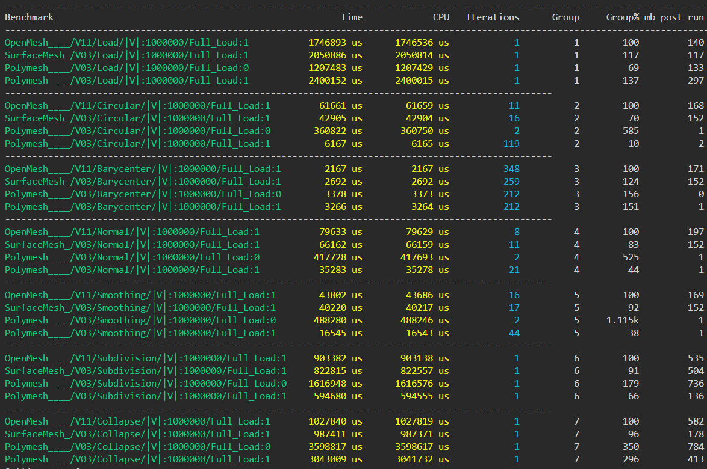
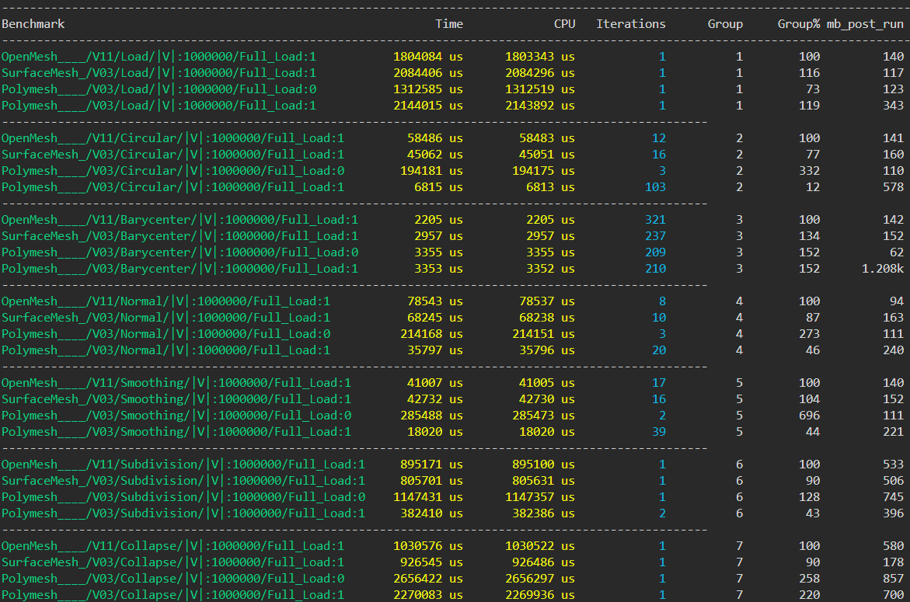

---------------------------------------------------------------------------------------------------------------------------------
Benchmark                                                     Time             CPU   Iterations      Group     Group% mb_post_run
---------------------------------------------------------------------------------------------------------------------------------
OpenMesh____/V11/Load/|V|:1000000/Full_Load:1           1653005 us      1652917 us            1          1        100         140
SurfaceMesh_/V03/Load/|V|:1000000/Full_Load:1           1940648 us      1940571 us            1          1        117         117
Polymesh____/V03/Load/|V|:1000000/Full_Load:0           1576195 us      1576157 us            1          1         95         192
Polymesh____/V03/Load/|V|:1000000/Full_Load:1           1892414 us      1892287 us            1          1        114          81
-----------------------------------------------------------------------------------------------------
OpenMesh____/V11/Circular/|V|:1000000/Full_Load:1         55661 us        55655 us           13          2        100         169
SurfaceMesh_/V03/Circular/|V|:1000000/Full_Load:1         44523 us        44516 us           16          2         80         152
Polymesh____/V03/Circular/|V|:1000000/Full_Load:0        334682 us       334657 us            2          2        601           0
Polymesh____/V03/Circular/|V|:1000000/Full_Load:1          5779 us         5778 us          122          2         10           1
-----------------------------------------------------------------------------------------------------
OpenMesh____/V11/Barycenter/|V|:1000000/Full_Load:1        1998 us         1999 us          347          3        100         171
SurfaceMesh_/V03/Barycenter/|V|:1000000/Full_Load:1        2550 us         2549 us          273          3        128         152
Polymesh____/V03/Barycenter/|V|:1000000/Full_Load:0        2897 us         2897 us          242          3        145           0
Polymesh____/V03/Barycenter/|V|:1000000/Full_Load:1        3508 us         3507 us          223          3        176           0
-----------------------------------------------------------------------------------------------------
OpenMesh____/V11/Normal/|V|:1000000/Full_Load:1           87011 us        87007 us            8          4        100         187
SurfaceMesh_/V03/Normal/|V|:1000000/Full_Load:1           64143 us        64137 us           11          4         74         152
Polymesh____/V03/Normal/|V|:1000000/Full_Load:0          395598 us       395145 us            2          4        455           0
Polymesh____/V03/Normal/|V|:1000000/Full_Load:1           35632 us        35629 us           20          4         41           0
-----------------------------------------------------------------------------------------------------
OpenMesh____/V11/Smoothing/|V|:1000000/Full_Load:1        42615 us        42610 us           16          5        100         169
SurfaceMesh_/V03/Smoothing/|V|:1000000/Full_Load:1        40252 us        40248 us           17          5         94         152
Polymesh____/V03/Smoothing/|V|:1000000/Full_Load:0       456461 us       456374 us            2          5     1.071k           0
Polymesh____/V03/Smoothing/|V|:1000000/Full_Load:1        17540 us        17538 us           42          5         41          27
-----------------------------------------------------------------------------------------------------
OpenMesh____/V11/Subdivision/|V|:1000000/Full_Load:1     918360 us       918255 us            1          6        100         536
SurfaceMesh_/V03/Subdivision/|V|:1000000/Full_Load:1     828818 us       828747 us            1          6         90         505
Polymesh____/V03/Subdivision/|V|:1000000/Full_Load:0    1609404 us      1609299 us            1          6        175         799
Polymesh____/V03/Subdivision/|V|:1000000/Full_Load:1     591754 us       591704 us            1          6         64         111
-----------------------------------------------------------------------------------------------------
OpenMesh____/V11/Collapse/|V|:1000000/Full_Load:1       1068659 us      1068562 us            1          7        100         567
SurfaceMesh_/V03/Collapse/|V|:1000000/Full_Load:1        994108 us       993973 us            1          7         93         186
Polymesh____/V03/Collapse/|V|:1000000/Full_Load:0       3907155 us      3906103 us            1          7        366         862
Polymesh____/V03/Collapse/|V|:1000000/Full_Load:1       3880719 us      3879090 us            1          7        363         264

